<picture>
  <source media="(prefers-color-scheme: dark)" srcset="./assets/singularity-hero-dark.svg">
  
</picture>

<b>Dat Pham (@datphalm)</b> · AI Agent Security, Systems & Multimodal Tooling

  
  

> **Mission brief.** Systems & AI engineer building fail-closed agent sandboxes, out-of-core columnar data engines, multimodal MCP skills, and physics-driven desktop craft — from OS-level security proxies in **Go** & **Rust** to audio-visual reasoning pipelines in **Python** & **WebGL**.
>
> **Current objective.** Advancing autonomous AI agent security (`ghostcage`), semantic Parquet/CSV diffing (`parqdiff`), multimodal video perception (`YVS`), and tactile Windows desktop experiences (`antigravity-liftoff`).

#### Telemetry

<picture>
  <source media="(prefers-color-scheme: dark)" srcset="./assets/singularity-telemetry-dark.svg">
  
</picture>

Reading the instruments

- **Accretion disk:** one relativistic particle arc per day of the last 365 days (log-quantile normalized); busier days glow brighter and orbit closer to the photon ring across three Keplerian speed bands.
- **Orbital plot:** log-scaled monthly contribution trajectory with a live radar beacon locked onto the peak output month.
- **Auto-updated daily:** regenerated automatically via GitHub Actions every 24 hours directly from live GitHub telemetry.
- **Dual-theme plates:** Interstellar black hole in Dark Mode; astronomical sky-survey negative plate in Light Mode.

#### Flight Deck

<picture>
  <source media="(prefers-color-scheme: dark)" srcset="./assets/singularity-missions-dark.svg">
  
</picture>

- `MSN-01` **[antigravity-liftoff](https://github.com/datphalm/antigravity-liftoff)** — Cinematic gravity-to-antigravity intro launcher for Google Antigravity on Windows with 2D physics, WebGL FX & Silver Ink theme.  
  `JavaScript · Python · WebGL` · ★ 1
- `MSN-02` **[YVS — YouTube Vision Skill](https://github.com/datphalm/YVS---Youtube-Vision-Skill)** — Multimodal MCP server & AI agent skill enabling agents to see and hear YouTube streams via scene extraction & timeline alignment.  
  `Python · MCP · Gemini · Whisper`
- `MSN-03` **ghostcage** *(Stealth / Private)* — Zero-trust secret-blind MITM proxy and OS sandbox for running autonomous AI coding agents without exposing credentials.  
  `Go · MITM Proxy · OS Sandbox`
- `MSN-04` **parqdiff** *(Stealth / Private)* — Semantic, out-of-core Parquet/CSV diff engine with zero-scan remote metadata inspection and native git diff integration.  
  `Rust · Apache Arrow · Parquet`

<picture>
  <source media="(prefers-color-scheme: dark)" srcset="./assets/singularity-end-dark.svg">
  
</picture>

