  

### Selected Work

| Project | Stack | Description |
| :--- | :---: | :--- |
| [**ghostcage**](https://github.com/datphalm/ghostcage) | `Go` | Zero-trust secret-blind MITM proxy and OS sandbox for running autonomous AI coding agents without exposing credentials. |
| [**parqdiff**](https://github.com/datphalm/parqdiff) | `Rust` | Semantic, out-of-core Parquet/CSV diff engine with zero-scan remote metadata inspection and native `git diff` integration. |

---

  <a href="mailto:datphalm13@gmail.com">Email</a> ·

